# AgentPulse

Watch your agents work. A native macOS app that shows what the AI coding agents on this
Mac are doing right now: tokens, estimated cost, runtime, CPU and memory, with a pixel cat
per agent whose behaviour follows the agent's real activity.

This is an early build: **Claude Code** and **Codex CLI** sessions, two screens (Overview and Sessions), a
menu-bar cat, and desktop widgets. See [docs/roadmap.md](docs/roadmap.md) for what is and is not built.

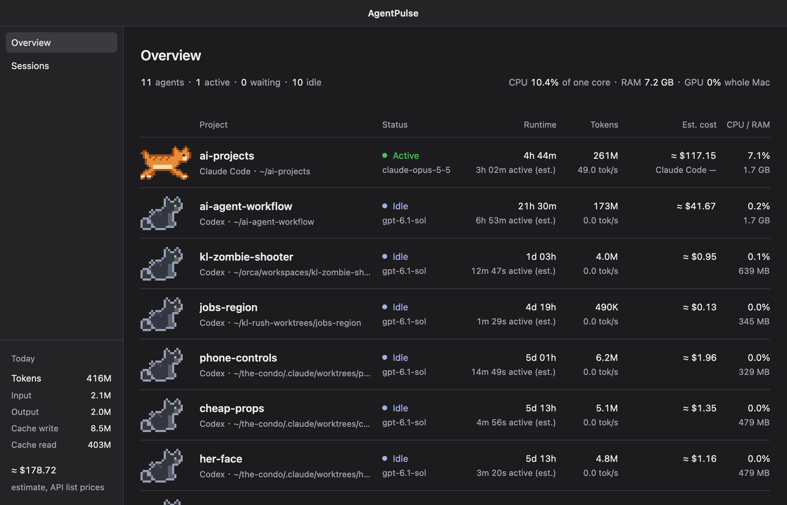

## Screenshots

Rendered by the app and its widget views from live Claude Code sessions. They are not
screen captures of a real menu bar or desktop.

### Window

| Overview, light | Sessions |
|---|---|
| 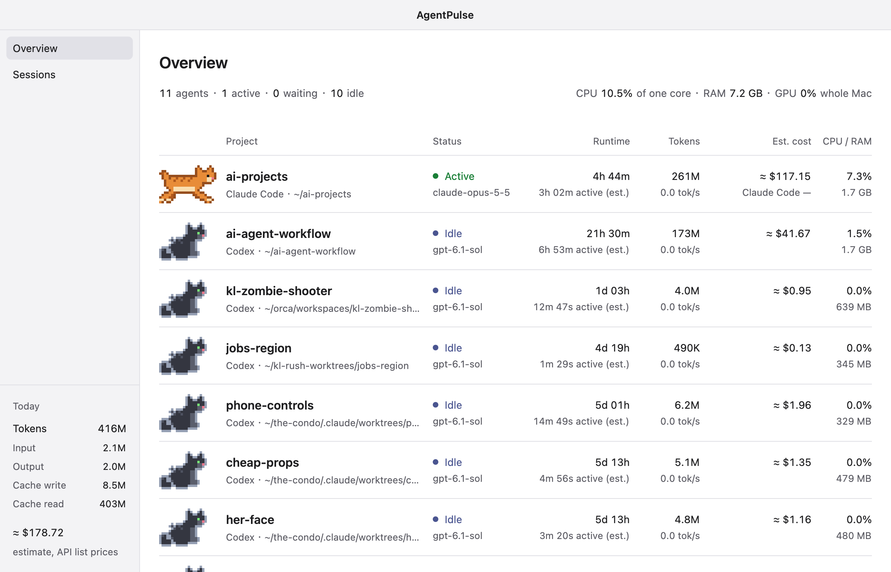 | 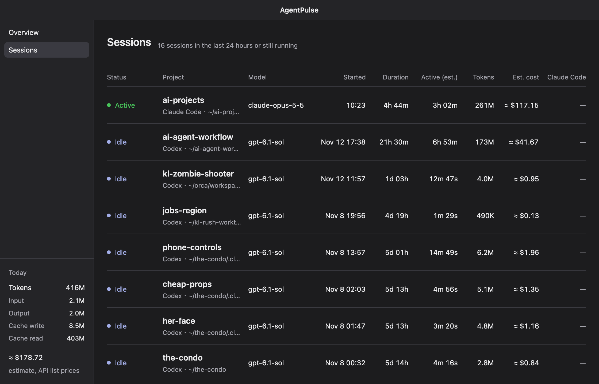 |
| **Minimum size, 880 × 560.** Fewer columns, no sideways scroll. | **No agents.** The empty state. |
| 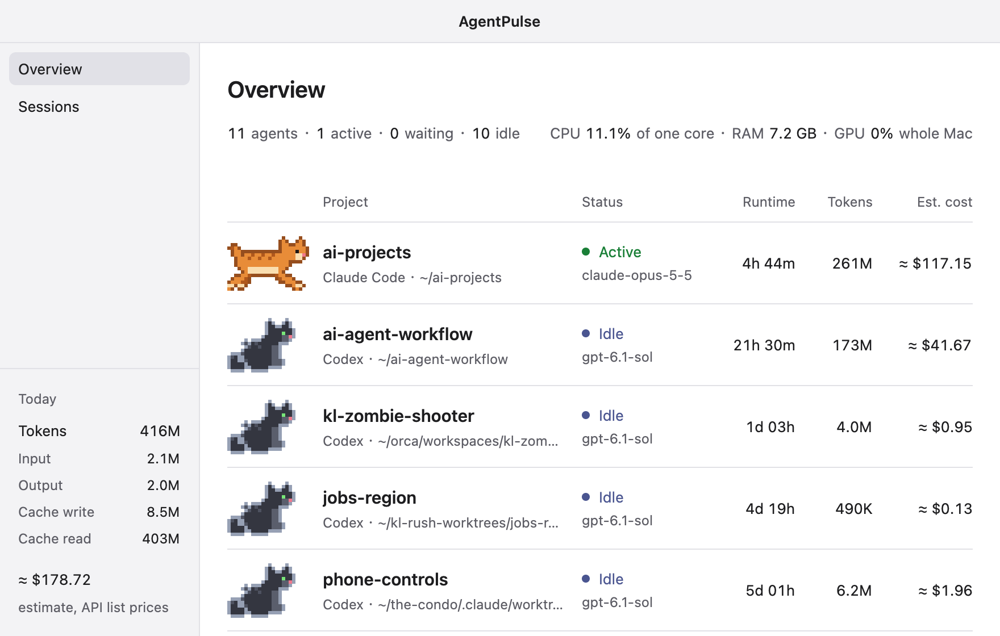 | 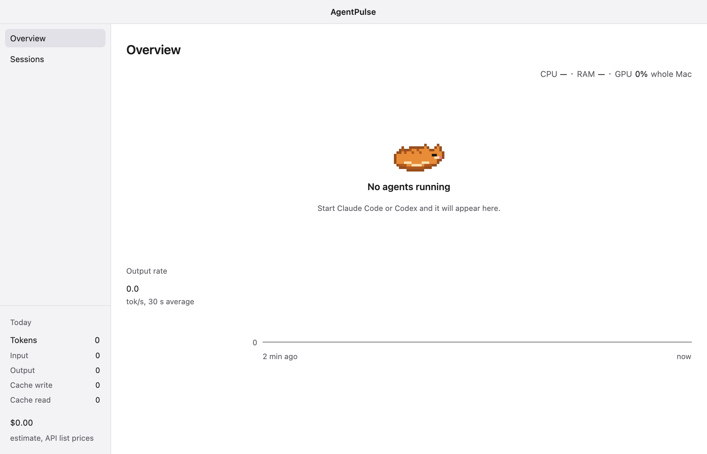 |

### Menu bar

One cat follows overall activity, next to the number of active agents. Each preview shows
the template image on a light and a dark bar, enlarged 8×.

| Sleeping | Sitting | Looking around | Running | Wind-up | Sprinting | Skid |
|:-:|:-:|:-:|:-:|:-:|:-:|:-:|
| 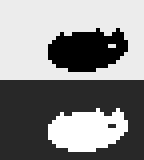 | 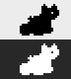 | 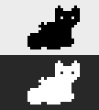 | 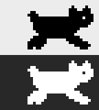 | 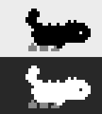 | 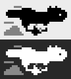 | 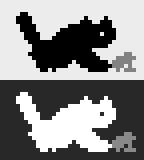 |
| No agents | Idle | Waiting on you | Working | Before a sprint | Heavy output | Stopping |

### Widgets

<p>
  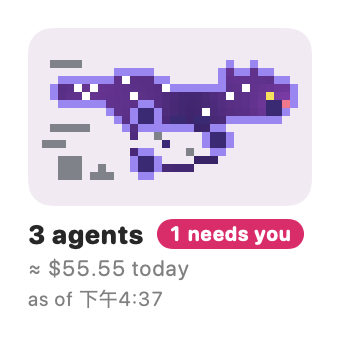
  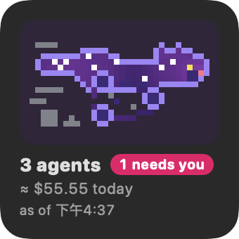
  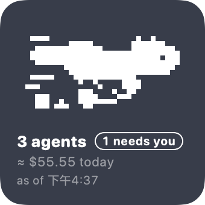
</p>
<p>
  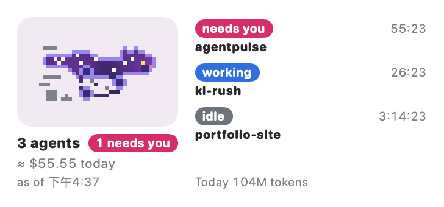
  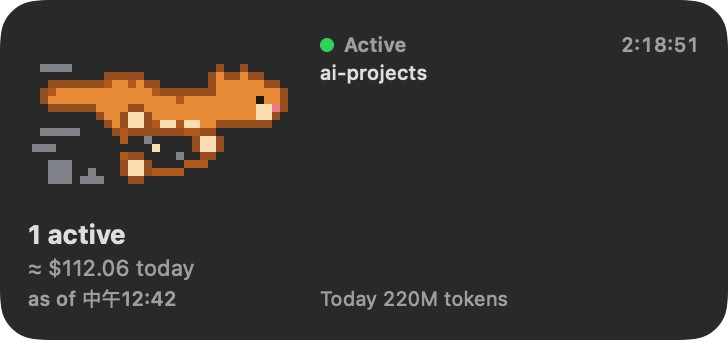
</p>
<p>
  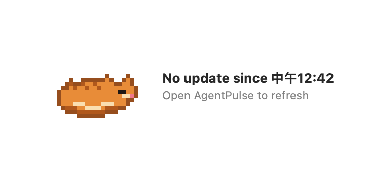
  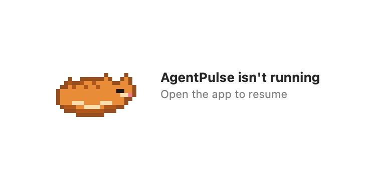
</p>

Small and medium, light, dark and tinted; then the old-data state (nothing for 75 minutes)
and the app-not-running state.

### Cat in motion

Sprite loops at their real frame timing, on a light and a dark half. The sprint appears only
under heavy output, with a wind-up when it starts and a skid when it stops.

| Running | Wind-up | Sprinting | Skid |
|:-:|:-:|:-:|:-:|
| 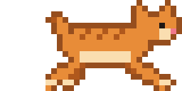 | 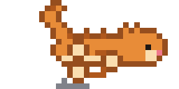 | 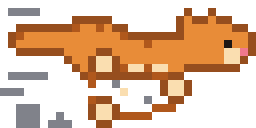 |  |

## What it does

- Finds Claude Code and Codex sessions, including subagents, and tails their transcripts.
  Each row says which agent it is.
- Counts tokens once per API response (Claude Code logs each response several times).
  From Codex rollouts it reads only metadata records; message, tool and reasoning lines are
  skipped without being parsed.
- Estimates cost from an editable price table. Costs are always labelled as estimates.
- Maps each running session to its process by PID and start time (for Codex, the process
  holding its rollout open), and measures the CPU and resident memory of its whole process
  tree. A Codex process that hosts several sessions is shown as unavailable rather than
  split between them.
- Shows status from the agent's own state: active, waiting, idle, completed, failed
  (Codex reports only active and idle while running).
- Keeps history in a local SQLite database.
- Animates one cat per live agent: sitting when idle, looking around when waiting, running
  when working, and a cartoon-style sprint (spinning legs, speed lines, dust) under heavy
  output.
- Lives in the menu bar: a cat that follows overall activity, the number of active agents,
  and a menu with today's figures. Closing the window keeps it running.
- Small and medium desktop widgets (see [macos/README.md](macos/README.md)).

Everything stays on this machine. AgentPulse makes no network calls and never reads or
stores prompt, response or file content. Values it cannot measure are shown as unavailable,
not as zero.

## Requirements

- macOS 14 or later on Apple Silicon (developed on macOS 27).
- Rust (stable) and Xcode command line tools.

## Build and run

```sh
cargo run --release -p agentpulse-app          # the app
cargo run --release -p agentpulse-app -- --dump    # one snapshot as JSON, no window
cargo run --release -p agentpulse-app -- --bench   # collector overhead over 20 s
cargo test --workspace
scripts/bundle.sh                                  # signed AgentPulse.app with widgets
scripts/bundle.sh --dmg                            # the same, plus a DMG
scripts/bundle.sh --release                        # Developer ID, notarized DMG (see macos/README.md)
```

The first build fetches GPUI from the Zed repository at a pinned commit and takes a few
minutes.

## Configuration

| Setting | How |
|---|---|
| Data directory | `AGENTPULSE_DATA_DIR` (default `~/Library/Application Support/AgentPulse`) |
| Claude Code directory | `CLAUDE_CONFIG_DIR` (default `~/.claude`) |
| Codex directory | `CODEX_HOME` (default `~/.codex`) |
| Prices | Put a `pricing.toml` in the data directory; it replaces the built-in table. Format: [crates/agentpulse-cost/pricing.toml](crates/agentpulse-cost/pricing.toml) |
| Animation off | `AGENTPULSE_ANIMATION=off`, or macOS Reduce Motion |
| Animation speed | `AGENTPULSE_ANIMATION_SPEED=1.5` (0.25 to 3) |
| Log level | `AGENTPULSE_LOG=debug` |

## Documentation

- [docs/repository-audit.md](docs/repository-audit.md): what was learned from related projects and GPUI.
- [docs/architecture.md](docs/architecture.md): crates, data flow and decisions.
- [docs/telemetry-spec.md](docs/telemetry-spec.md): what is read, how each number is derived, and how sure it is.
- [docs/roadmap.md](docs/roadmap.md): status and next steps.

## License

Licensed under either of [Apache License, Version 2.0](LICENSE-APACHE) or [MIT license](LICENSE-MIT), at your option.
