<p align="center">
  <picture>
    <source media="(prefers-color-scheme: dark)" srcset="assets/logo/icon-dark.png">
    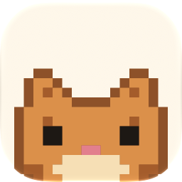
  </picture>
</p>

# AgentPulse

Watch your agents work. A native macOS app that shows what the AI coding agents on this
Mac are doing right now: tokens, estimated cost, runtime, CPU and memory, with a pixel cat
per agent whose behaviour follows the agent's real activity.

This is an early build: **Claude Code** and **Codex CLI** sessions, five screens (Overview,
Sessions with a per-session detail, Usage, Clean-up and Cats), a menu-bar cat, and desktop widgets. See
[docs/roadmap.md](docs/roadmap.md) for what is and is not built.

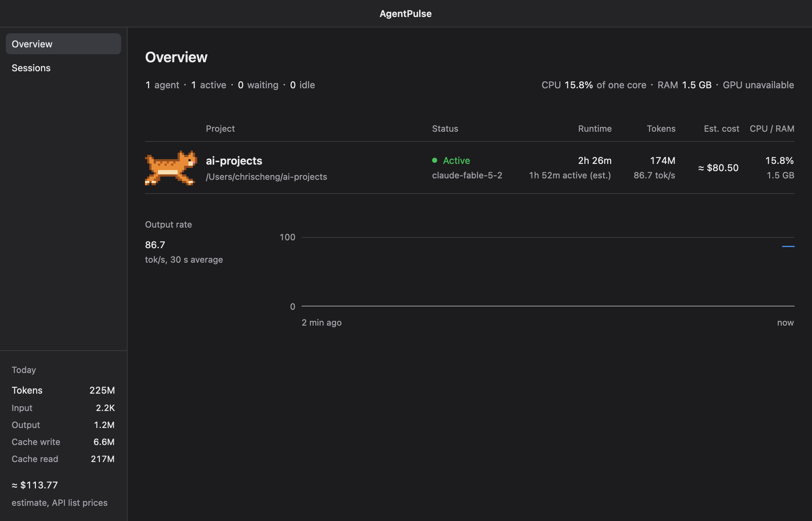

## Screenshots

The window images are rendered by the app's own screenshot mode from the developer's live
Claude Code and Codex sessions. The widget images are rendered by the widget views from a
sample data file. None of them are screen captures of a real menu bar or desktop.

### Window

| Overview, light | Sessions |
|---|---|
| 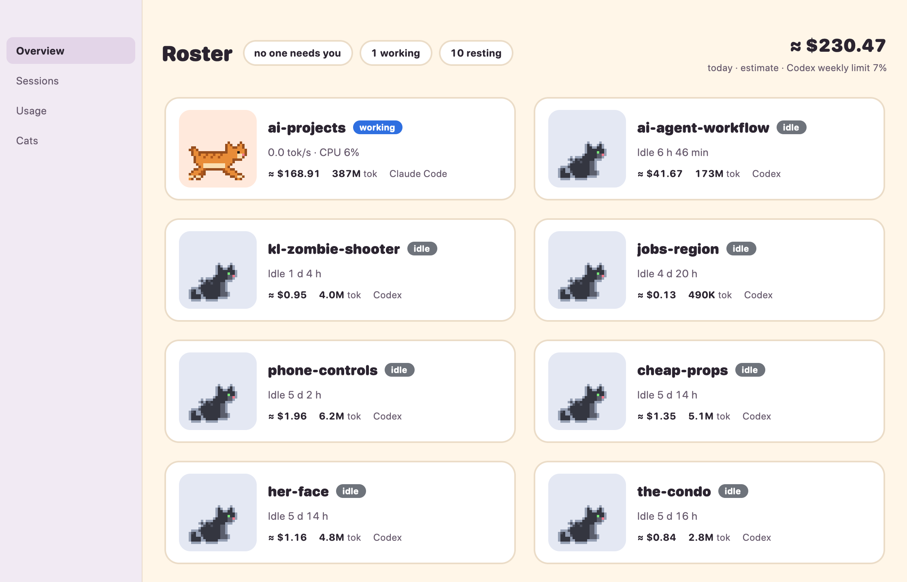 | 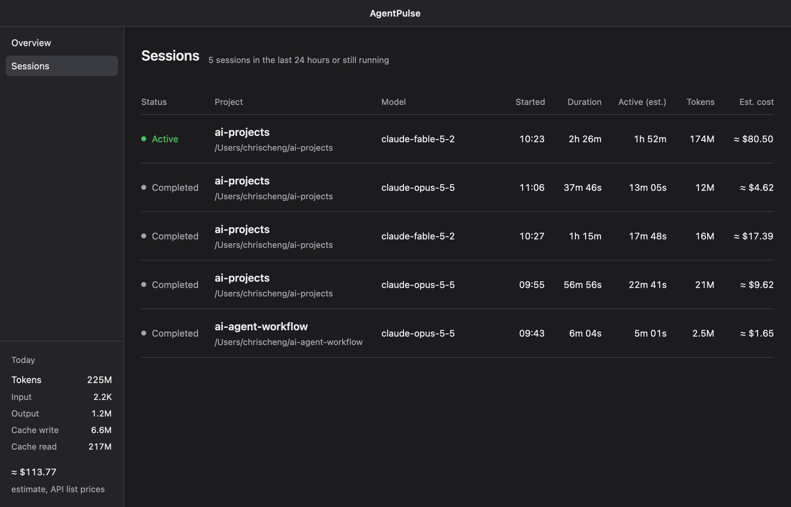 |
| **Minimum size, 880 × 560.** Fewer columns, no sideways scroll. | **No agents.** The empty state. |
| 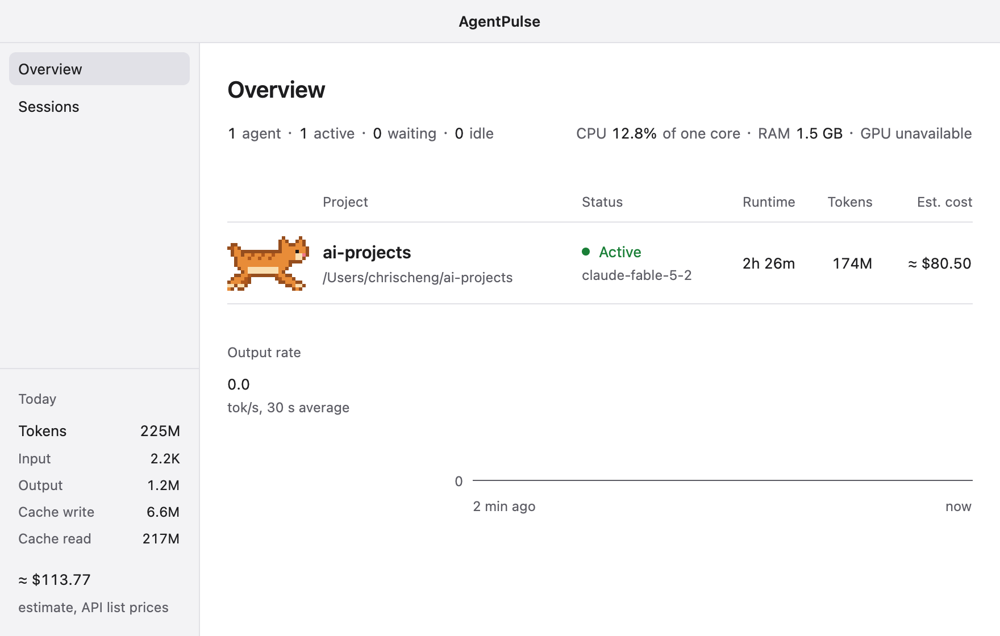 | 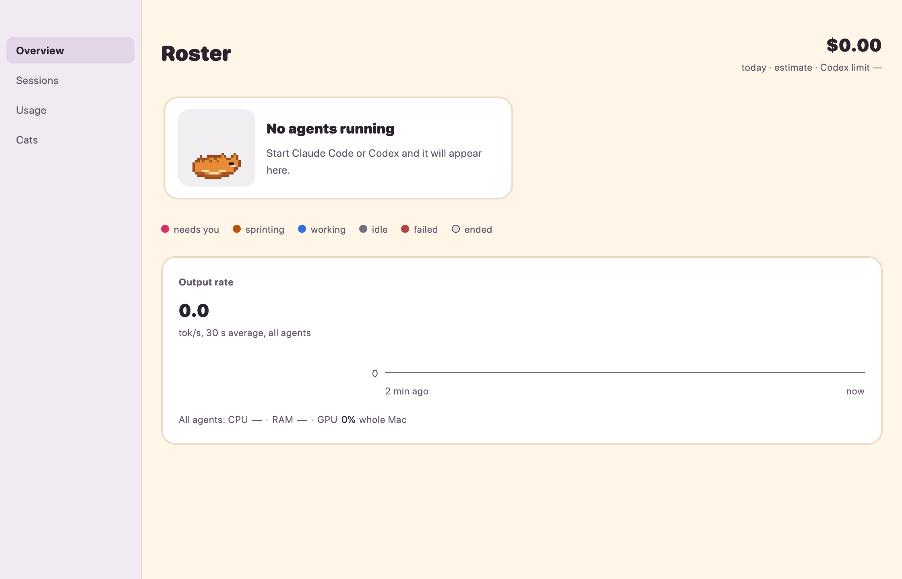 |
| **Usage.** Daily estimated cost, cache efficiency, today's timeline. | **Session detail.** Context size per request and running cost. |
| 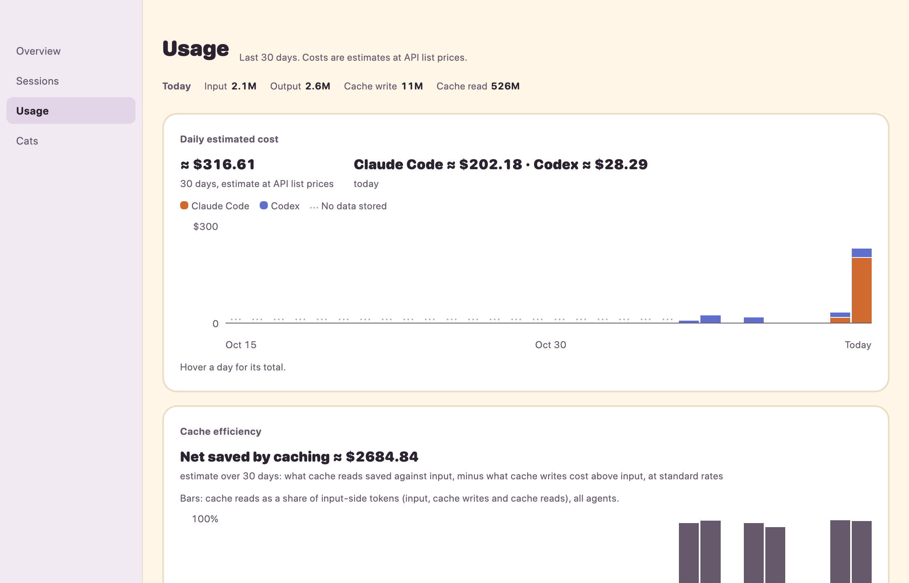 | 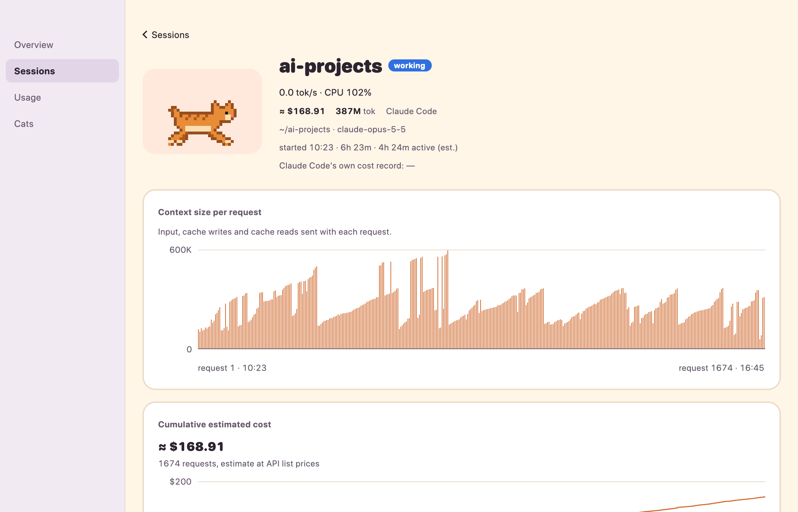 |
| **Cats.** A coat and eye colour per agent. | |
| 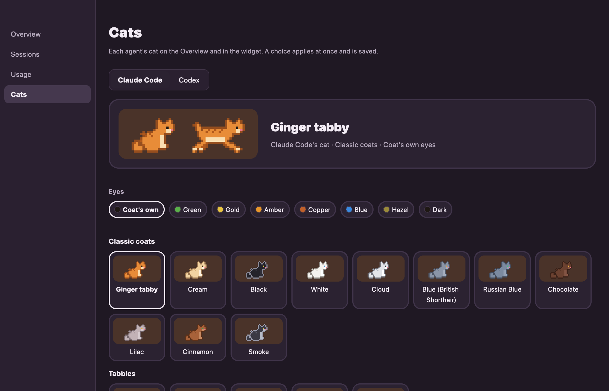 | |

### Menu bar

One cat follows overall activity, next to the number of active agents. Each preview shows
the template image on a light and a dark bar, enlarged 8×.

| Sleeping | Sitting | Looking around | Running | Wind-up | Sprinting | Skid |
|:-:|:-:|:-:|:-:|:-:|:-:|:-:|
| 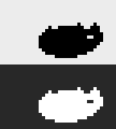 | 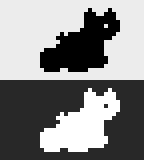 | 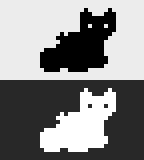 | 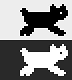 | 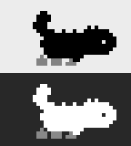 | 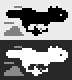 | 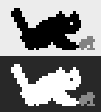 |
| No agents | Idle | Waiting on you | Working | Before a sprint | Heavy output | Stopping |

### Widgets

<p>
  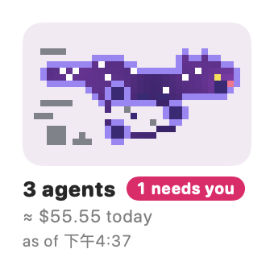
  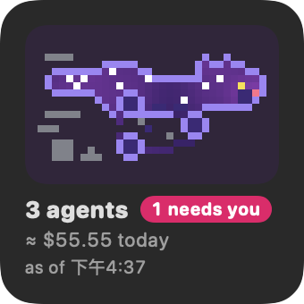
  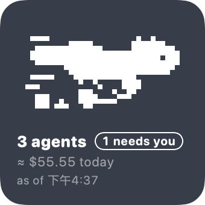
</p>
<p>
  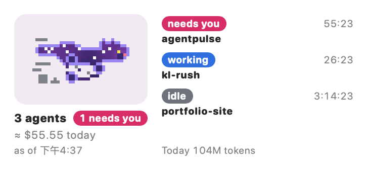
  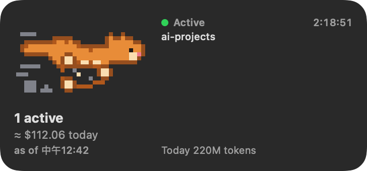
</p>
<p>
  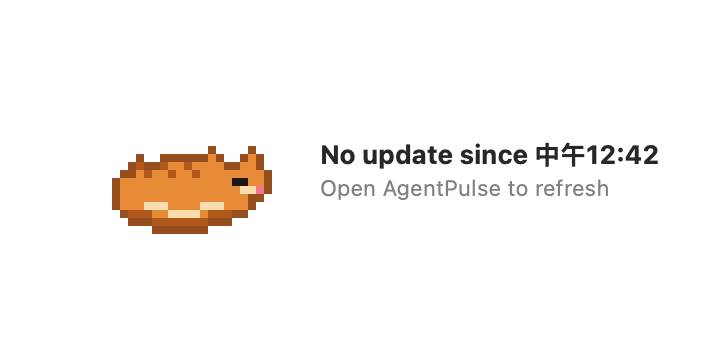
  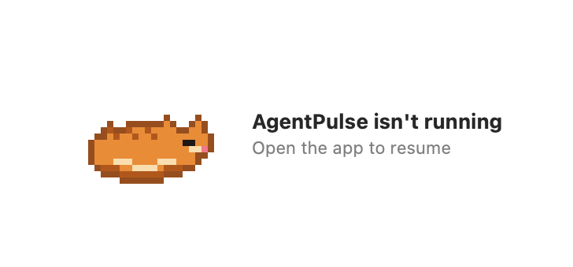
</p>

Small and medium, light, dark and tinted; then the old-data state (nothing for 75 minutes)
and the app-not-running state.

### Cat in motion

Sprite loops at their real frame timing, on a light and a dark half. The sprint appears only
under heavy output, with a wind-up when it starts and a skid when it stops.

| Running | Wind-up | Sprinting | Skid |
|:-:|:-:|:-:|:-:|
|  |  | 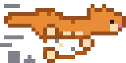 |  |

## What it does

- Finds Claude Code and Codex sessions, including subagents, and tails their transcripts.
  Each row says which agent it is.
- Counts tokens once per API response (Claude Code logs each response several times).
  From Codex rollouts it reads only metadata records; message, tool and reasoning lines are
  skipped without being parsed.
- Estimates cost from an editable price table. Costs are always labelled as estimates.
- Maps each running session to its process by PID and start time (for Codex, the process
  holding its rollout open), and measures the CPU and resident memory of its whole process
  tree. A Codex process that hosts several sessions is shown as unavailable rather than
  split between them.
- Shows status from the agent's own state: active, waiting, idle, completed, failed
  (Codex reports only active and idle while running).
- Keeps history in a local SQLite database.
- Usage screen: estimated cost per day for 30 days by agent, cache efficiency and what
  caching saved, today's sessions on a timeline, and each agent's plan limit (Claude Code's
  needs the status line command under [Claude Code plan limits](#claude-code-plan-limits)). Clicking a session
  shows its context size per request and its cumulative estimated cost. Days with no stored
  data are drawn as such, never as zero.
- Lets you dress each agent's cat: 47 coats (tabbies, calico, colourpoints, a galaxy…)
  and 7 eye colours, on the Cats screen. The widget follows; the menu-bar cat stays monochrome.
- Animates one cat per live agent: sitting when idle, looking around when waiting, running
  when working, and a cartoon-style sprint (spinning legs, speed lines, dust) under heavy
  output.
- Lives in the menu bar: a cat that follows overall activity, the number of active agents,
  and a menu with today's figures. Closing the window keeps it running.
- Small and medium desktop widgets (see [macos/README.md](macos/README.md)). The widget's cat
  wears the coat of the agent it follows, so with default settings a widget driven by Codex
  shows Codex's dark cat, not the ginger one.

Everything stays on this machine unless you pair a phone (below). AgentPulse never reads or
stores prompt, response or file content. Without a paired phone it makes one kind of network
request on its own: the update check, an HTTPS
`GET https://api.github.com/repos/chengboonrong/agentpulse/releases?per_page=10` with the
headers `User-Agent: AgentPulse/<version>`, `Accept: application/vnd.github+json` and
`Accept-Language: en`, plus the standard `Accept-Encoding` that macOS adds. It sends no
cookies, identifiers or anything about you or your agents; like any connection, GitHub sees
your IP address. GitHub replies with the public list of AgentPulse releases, from
which AgentPulse reads each version, date, notes and page link. It checks every 2 hours by
default; turn off "Check for updates automatically" in Settings to stop that. "Check Now"
works either way. Nothing is downloaded or installed by itself: a new release shows a
notice. Only clicking "Install Update" (in the notice or Settings) or the menu's "Update
Available" item starts the installer, [Sparkle](https://sparkle-project.org), which then
asks GitHub for
`https://github.com/chengboonrong/agentpulse/releases/latest/download/appcast.xml` and,
once you confirm in its window, downloads that release's `AgentPulse-<version>.zip`
(GitHub redirects both to `release-assets.githubusercontent.com`). These requests send
`User-Agent: AgentPulse/<version>`, `Accept-Language: en`, an `Accept` header and the
standard `Accept-Encoding`, no cookies and no system profile. A pre-release is not offered
to Sparkle; its button opens the release's GitHub page. Sparkle installs the update only
if its signature checks out, and keeps the running version otherwise. Values AgentPulse
cannot measure are shown as unavailable, not as zero.

Phones (in the sidebar; opt-in, see [docs/mobile.md](docs/mobile.md)) make no request until
a phone is being paired or is paired. Pairing goes through the AgentPulse relay at
`relay.snitco.com` unless you set your own relay address. A paired phone gets the
widget's metadata (live sessions with their project's folder name, today's tokens and cost,
the output rate, the cat), never paths, prompts or code, sealed end to end for that phone.
The relay stores that ciphertext and passes on the phone's sealed replies; it can't read
either. "Direct connection" (on by default) also sends
it straight to the phone on the same network: the Mac advertises Bonjour `_agentpulse._tcp`
while a phone is paired, and the connection is encrypted with the pairing's keys.

## Requirements

- macOS 14 or later on Apple Silicon (developed on macOS 27).
- Rust (stable) and Xcode command line tools; Xcode 26 or later to bundle the app
  (`scripts/bundle.sh`) or build the iPhone app.

## Build and run

```sh
cargo run --release -p agentpulse-app          # the app
cargo run --release -p agentpulse-app -- --dump    # one snapshot as JSON, no window
cargo run --release -p agentpulse-app -- --bench   # collector overhead over 20 s
cargo test --workspace
scripts/bundle.sh                                  # signed AgentPulse.app with widgets
scripts/bundle.sh --dmg                            # the same, plus a DMG
scripts/bundle.sh --release                        # Developer ID, notarized DMG (see macos/README.md)
```

The first build fetches GPUI from the Zed repository at a pinned commit and takes a few
minutes.

## Configuration

| Setting | How |
|---|---|
| Data directory | `AGENTPULSE_DATA_DIR` (default `~/Library/Application Support/AgentPulse`) |
| Claude Code directory | `CLAUDE_CONFIG_DIR` (default `~/.claude`) |
| Codex directory | `CODEX_HOME` (default `~/.codex`) |
| Prices | Put a `pricing.toml` in the data directory; it replaces the built-in table. Format: [crates/agentpulse-cost/pricing.toml](crates/agentpulse-cost/pricing.toml) |
| Animation on/off | The Settings screen. `AGENTPULSE_ANIMATION=on` or `off` overrides it; macOS Reduce Motion always stops it |
| Animation speed | The Settings screen. `AGENTPULSE_ANIMATION_SPEED=1.5` (0.25 to 3) overrides it |
| Log level | `AGENTPULSE_LOG=debug` |
| Cat coats | The **Cats** screen: pick an agent, then a coat and an eye colour. Saved at once to `settings.json` in the data directory |

### Claude Code plan limits

Claude Code writes its 5-hour and weekly plan usage nowhere on disk. It hands it only to a
[status line command](https://code.claude.com/docs/en/statusline), and only on Pro, Max
and Ultra plans. AgentPulse does not change your Claude Code settings. To show these limits,
set `statusLine` yourself in Claude Code's `settings.json` (in `~/.claude`, unless you set
`CLAUDE_CONFIG_DIR`):

```json
"statusLine": {
  "type": "command",
  "command": "p=$(cat); case $p in *'\"rate_limits\"'*) f=\"${CLAUDE_CONFIG_DIR:-$HOME/.claude}/agentpulse-rate-limits.json\"; printf %s \"$p\" > \"$f.$$\" && mv \"$f.$$\" \"$f\";; esac; printf %s \"$p\" | { YOUR_STATUS_LINE; }"
}
```

Replace `YOUR_STATUS_LINE` with the value of your current `statusLine.command`, pasted
exactly as it appears in `settings.json`. If you have none, delete
`; printf %s \"$p\" | { YOUR_STATUS_LINE; }`. The command saves Claude Code's status line data
to `agentpulse-rate-limits.json`, then passes it on unchanged. That data is session metadata
such as the model, working directory and cost, not prompts or responses. AgentPulse
deserializes only its `rate_limits`. The reading is as current as Claude Code's last status
line update. To stop, restore your old `statusLine`, delete the file, and reopen AgentPulse.

## Documentation

- [docs/repository-audit.md](docs/repository-audit.md): what was learned from related projects and GPUI.
- [docs/architecture.md](docs/architecture.md): crates, data flow and decisions.
- [docs/telemetry-spec.md](docs/telemetry-spec.md): what is read, how each number is derived, and how sure it is.
- [docs/roadmap.md](docs/roadmap.md): status and next steps.

## License

Licensed under either of [Apache License, Version 2.0](LICENSE-APACHE) or [MIT license](LICENSE-MIT), at your option.
